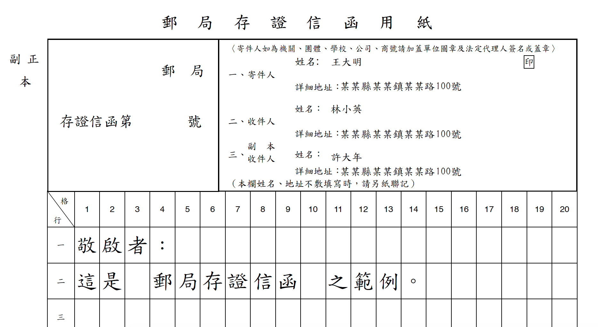

# Legal Attest Letter Generator - Taiwan #
台灣郵局存證信函產生器 (PDF 格式)。  
A tool for creating a legal attest letter of Taiwan - in PDF format.



## Feature ##
- 輸出整齊、美觀的信函  
  The output is neat and beautiful.  

- 可指定任意數目之姓名、地址  
  You can specify any number of names or addresses.  

- 可排版：只需用純文字編輯器打好內容並排版，便會反應至信函上，使內容不至於擁擠  
  Support indentation: The only thing you have to do is typing your main article and indenting them on a text editor. The output will reflect your indentation so that the main article won't look crowded.  

- 可免費離線使用，提供命令列、桌面圖形介面（Tkinter）、瀏覽器介面（Web UI）三種操作方式，皆不需額外安裝套件  
  You can use it offline for free. Three interfaces are available: CLI, a desktop GUI (Tkinter), and a browser-based Web UI — none require installing extra packages.

- Web UI 提供即時預覽：填寫寄件人／收件人／副本收件人資訊與內文時，右側會即時顯示排版後的信紙格網樣式，跟正式輸出的斷行、分頁邏輯一致  
  The Web UI shows a real-time layout preview as you fill in sender/receiver/cc info and the article — the line-wrap and page-break logic mirrors the actual PDF output.

- 開源：程式實作完全開放閱覽，無隱私問題，過程完全透明  
  Open source: You are free to read the code. No privacy issue. The process is totally transparent.

## Download The Latest Version ##
Please click [here](https://github.com/csterryliu/Legal-Attest-Letter-Generator-TW/releases/download/v2.1.1/Legal-Attest-Letter-Generator-TW-v2.1.1.zip). For more detail, please head to [Releases](https://github.com/csterryliu/Legal-Attest-Letter-Generator-TW/releases).

## How To Use It ##
Please read [Wiki](https://github.com/csterryliu/Legal-Attest-Letter-Generator-TW/wiki/) for the CLI and desktop GUI.

To launch the Web UI (opens your default browser at `http://127.0.0.1:8420/`):
```bash
python tw-lal-generator-webui.py
```
Windows 使用者可直接雙擊 `start_webui.bat` 啟動，不需自行輸入指令；此捷徑會自動處理下方「已知限制」提到的相依套件問題。
Use `--port <N>` to change the port, or `--no-browser` to skip auto-opening a browser tab. The Web UI only uses Python's standard library on the server side (`http.server`) — no `pip install` is required beyond the same PyPDF2/reportlab dependency the CLI/GUI already need.

**已知限制**：隨附於 `dep/` 的 PyPDF2、reportlab 是 2016 年的舊版本；在 Python 3.12+ 環境下，vendored 版的 reportlab 會因為使用已被移除的 `imp` 模組而無法載入（vendored PyPDF2 本身在 3.12 沒有問題）。若在 Python 3.12+ 上執行任何一種介面（CLI／GUI／Web UI），暫時需要改用 `pip install reportlab` 提供的新版取代 vendored 版本。

## Dependency ##
- [PyPDF2 1.26](https://github.com/mstamy2/PyPDF2)  
- [reportlab 3.3.0](https://bitbucket.org/rptlab/reportlab)
- [Letter sample provided by Post Office of Taiwan](http://www.post.gov.tw/post/internet/Download/index.jsp?ID=220301)
- [Traditional Chinese font provided by National Development Council, Taiwan ](http://data.gov.tw/node/5961)

## Roadmap ##
- ~~Provide online web service~~ (done: `tw-lal-generator-webui.py`)
- ~~Provide offline application GUI~~ (done: `tw-lal-generator-gui.py`)
- Compatible with Python 2.7
- Keep matching PEP8
- Update vendored PyPDF2/reportlab (or switch to `pip install`) for Python 3.12+ compatibility

## License ##
MIT
